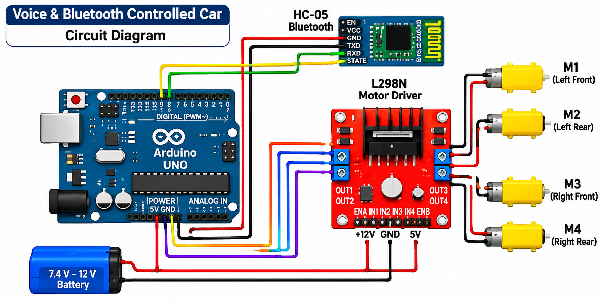

## Project Overview

This project is a four-wheel robotic car built using Arduino UNO. It supports wireless movement control through a Bluetooth connection and voice commands from a mobile application.

## Components Used

- Arduino UNO
- HC-05 Bluetooth Module
- L298N Motor Driver
- 4 DC Motors
- Robot Car Chassis
- Battery
- Connecting Wires

## Working Principle

The mobile application sends control commands through Bluetooth. The HC-05 module receives the commands and communicates with the Arduino UNO. The Arduino processes the commands and controls the four motors through the L298N motor driver.

## Supported Movements

- Forward
- Backward
- Left
- Right
- Stop

## Circuit Diagram

## Arduino Source Code

[View Arduino Code](Voice-Bluetooth-Car.ino)

## Project Status

Hardware project documentation and prototype code.
